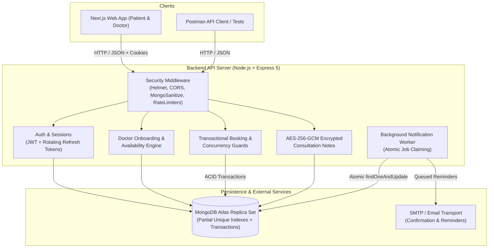

# Medconsults — Developer Handover & Architecture Guide

Welcome to the **Medconsults** codebase. This guide contains everything a new developer needs to understand the architecture, run the system locally, and continue building from where the backend was left.

---

## 1. System Architecture Overview

Medconsults is a single-clinic-per-doctor practice management and in-clinic consultation booking platform built on **Express 5**, **TypeScript (Strict)**, and **MongoDB Atlas (Mongoose)**.



---

## 2. Core Invariants & Architectural Decision Records (ADRs)

1. **One Doctor = One Clinic = One Account**
   * A doctor account maps 1:1 to their clinic. No multi-tenant clinic switcher complexity in MVP.
2. **Time Storage Standard**
   * **Appointments are stored in UTC**: `startAt` and `endAt` are ISO UTC strings.
   * **Clinic schedules are in clinic-local time**: The doctor profile stores the IANA timezone (e.g. `Asia/Kolkata`). Slots are computed on-the-fly and converted to UTC on the server.
3. **Double-Booking Prevention**
   * Two layers of defense:
     1. In-transaction range overlap check: `startAt < existingEndAt && endAt > existingStartAt`.
     2. Database backstop: MongoDB partial unique index on `(doctorId, startAt)` for active statuses (`['pending', 'confirmed']`).
4. **Encryption at Rest for Medical Data**
   * Doctor consultation notes and reasons for visits are encrypted using **AES-256-GCM**.
   * Format: `v1:<hex_iv>:<hex_ciphertext>:<hex_auth_tag>`.
   * The `v1:` prefix guarantees smooth key rotation in future without breaking historical records.
5. **Session Security (Refresh Rotation & Family Revocation)**
   * Refresh cookie value is `<sessionId>.<secret>`.
   * Stored in DB: `sessionId`, `SHA-256(secret)`, `familyId`, `expiresAt`.
   * Lookup by `sessionId`, comparison via `crypto.timingSafeEqual`.
   * On refresh, old secret is invalidated and new one issued under the same `familyId`.
   * If an old secret is presented again (replay attack), the entire `familyId` is deleted, logging out all compromised sessions.

---

## 3. "Day One" Quickstart

### Prerequisites
* **Node.js**: v20+ or Active LTS (tested on Node.js v24 LTS).
* **Package Manager**: npm v10+.
* **Database**: MongoDB Atlas or local MongoDB replica set (replica set is required for transactions).

### Setup Commands
```bash
# 1. Clone repository
git clone <repo-url>
cd "project medconsults"

# 2. Install dependencies
cd backend && npm install && cd ..

# 3. Start development server with live watch
npm run dev

# 4. Run automated test suites
npm run test:api       # Live end-to-end endpoint verification
npm run test:backend   # Security & concurrency simulation tests
```

---

## 4. Environment Variables Matrix (`backend/.env`)

| Variable Name | Required | Default / Example Value | Description |
|---|---|---|---|
| `NODE_ENV` | Yes | `development` | Environment mode (`development`, `production`, `test`). |
| `PORT` | Yes | `5001` | HTTP port the backend listens on. |
| `APP_BASE_URL` | Yes | `http://localhost:3000` | Frontend public origin used for generating email links. |
| `MONGODB_URI` | Yes | `mongodb+srv://...` | Connection URI. Replica set required for transactions. |
| `JWT_ACCESS_SECRET` | Yes | 32+ char hex string | Secret used to sign 15-minute access JWTs. |
| `JWT_REFRESH_SECRET` | Yes | 32+ char hex string | Secret used for signing session refresh tokens. |
| `JWT_ACCESS_EXPIRES_IN`| No | `15m` | Lifetime of in-memory access token. |
| `JWT_REFRESH_EXPIRES_IN`| No | `7d` | Lifetime of rotating refresh cookie. |
| `ENCRYPTION_KEY` | Yes | 64 char hex string (32 bytes) | AES-256-GCM key for general field encryption. |
| `NOTE_ENCRYPTION_KEY_V1`| Yes | 64 char hex string (32 bytes) | Key used for encrypting doctor consultation notes. |
| `CANCEL_WINDOW_HOURS` | No | `4` | Default hours before start time patient is allowed to cancel. |
| `DEFAULT_BOOKING_LIMIT` | No | `3` | Max active upcoming appointments per patient per doctor. |
| `CORS_ORIGINS` | Yes | `http://localhost:3000,http://localhost:5173` | Comma-separated allowlist of origins permitted by CORS. |
| `SMTP_HOST` | No | `smtp.ethereal.email` | Outbound email SMTP host. |
| `SMTP_PORT` | No | `587` | SMTP port (587 for TLS, 465 for SSL). |
| `SMTP_USER` | No | `test_user` | SMTP username. |
| `SMTP_PASS` | No | `test_pass` | SMTP password / app password. |
| `EMAIL_FROM` | No | `Medconsults <noreply@medconsults.com>` | Sender address on transactional emails. |

---

## 5. Database Collections & Indexing Reference

| Collection | Model Path | Purpose & Key Fields | Indexes |
|---|---|---|---|
| `users` | `backend/src/models/User.ts` | Credentials, contact phone, roles (`patient`/`doctor`/`admin`), verification. | Unique `email`, `role`, `createdAt`. |
| `sessions` | `backend/src/models/Session.ts` | Refresh token session families. | Unique `sessionId`, `userId`, TTL index on `expiresAt`. |
| `loginattempts`| `backend/src/models/LoginAttempt.ts`| Brute-force lockout counter. | Compound `email + ip`, TTL index on `expiresAt`. |
| `emailtokens` | `backend/src/models/EmailToken.ts` | Verification & reset token hashes. | Compound `userId + type`, TTL index on `expiresAt`. |
| `doctorprofiles`| `backend/src/models/DoctorProfile.ts` | Clinic info, slot settings, verification status. | Unique `userId`, unique `slug`, text index on `name, specialty, clinic.area, clinic.city`, 2dsphere on `clinic.geo`. |
| `availabilities`| `backend/src/models/Availability.ts` | Weekly operational hours & holidays. | Unique `doctorId`. |
| `blocks` | `backend/src/models/Block.ts` | Manual time-off and emergency blocks. | Compound `doctorId + startAt`. |
| `dependents` | `backend/src/models/Dependent.ts` | Patient family members. | Compound `patientUserId + name`. |
| `appointments` | `backend/src/models/Appointment.ts` | Bookings, status history, encrypted notes. | **Partial Unique** `(doctorId, startAt)` for active statuses, `bookedByUserId + startAt`. |
| `notificationjobs`| `backend/src/models/NotificationJob.ts`| Reminder queue. | Compound `status + runAt`. |
| `auditlogs` | `backend/src/models/AuditLog.ts` | Admin actions log. | `actorId`, `entity + entityId`, `createdAt`. |

---

## 6. Common Pitfalls & Solutions

1. **Windows Node.js c-ares DNS Bug (`querySrv ECONNREFUSED`)**
   * *Issue*: On Windows, Node defaults to `127.0.0.1` for DNS SRV records, failing MongoDB Atlas connection.
   * *Solution*: In `backend/src/config/db.ts`, fallback public DNS servers (`8.8.8.8`, `1.1.1.1`) are injected automatically when loopback DNS is detected.
2. **Winston Format Object Cloning**
   * *Issue*: Custom formatters reconstructing objects using `Object.entries()` drop Winston internal Symbol keys (`Symbol.for('level')`), causing `TypeError: colors[...] is not a function`.
   * *Solution*: In `backend/src/config/logger.ts`, `Object.getOwnPropertySymbols(obj)` is explicitly preserved.
3. **Express 5 `req.query` & `req.params` Getters**
   * *Issue*: In Express 5, `req.query` has only a getter on its prototype. Assigning `req.query = ...` throws `TypeError: Cannot set property query`.
   * *Solution*: In `backend/src/middleware/validate.ts`, `Object.defineProperty(req, 'query', { value: parsedQuery, writable: true, configurable: true })` is used.

---

## 7. Roadmap: What to Build Next

The backend API and database layer are 100% complete and verified. The next developer should focus on:

1. **Frontend App (`frontend/`)**:
   * Scaffold Next.js 14+ App Router with TypeScript and Tailwind CSS.
   * Configure the medical color palette token standard (`primary-600: #0E7C86`, `navy-900: #0B2A4A`, `surface: #FFFFFF`).
2. **Authentication Client**:
   * Implement in-memory access token store and Axios interceptor for automatic refresh cookie rotation.
3. **Doctor Onboarding & CRM Dashboard**:
   * Build onboarding wizard (Clinic info, fee, slot configuration).
   * Build doctor daily queue (`GET /api/v1/doctor/appointments?date=`) with one-tap arrived / completed / no-show status buttons.
4. **Patient Public Booking Flow**:
   * SSR doctor page (`/dr/[slug]`) with calendar slot picker and dependent selection.

